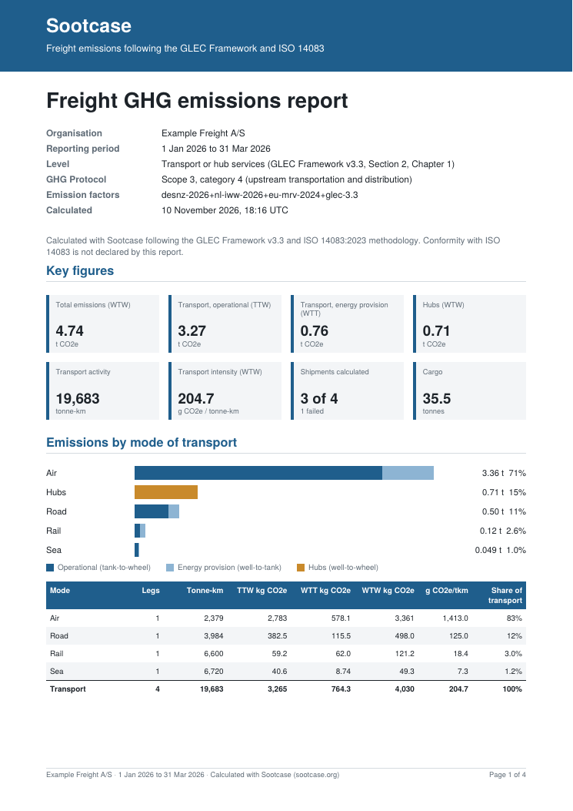

# sootcase-report

Turns a shipments CSV into a freight emissions report as a PDF, with the content ISO 14083 asks for at the level of transport or hub services. The calculation is done by [Sootcase](https://sootcase.org) (GLEC Framework v3.3, ISO 14083); this tool only lays out the answer.



[Sample PDF](docs/sample.pdf) · 4 pages: key figures, emissions by mode with a chart, hubs, energy carriers, GHG Protocol scopes, distance types and DAFs, data quality with every default value's source, the largest shipments, coverage and failures, notes on omissions.

## Use it

```sh
go install github.com/majidkabir/sootcase-report/cmd/sootcase-report@latest

export SOOTCASE_API_KEY=...        # from sootcase.org (sign in with your email)
sootcase-report -org "Acme Logistics" -from 2026-01-01 -to 2026-03-31 -scope3 4 -o q1.pdf shipments.csv
```

The CSV has [Sootcase's batch columns](https://github.com/majidkabir/sootcase#inputs), one row per leg or hub stop, up to 10,000 shipments (10 MiB) per report:

```csv
shipment_id,weight_kg,leg_id,mode,vehicle_type,from_code,to_code,distance_km,hub_id,hub_type
CPH-RTM-1,12000,truck,road,hgv,DKCPH,DEHAM,,,
CPH-RTM-1,,feeder,sea,container_ship,DEHAM,NLRTM,,,
CPH-FRA-AIR,800,flight,air,air_freight,CPH,FRA,,,
HAM-MIL-RAIL,20000,train,rail,freight_train,DEHAM,ITMIL,,,
HAM-MIL-RAIL,,,,,,,,dc,warehouse
```

| Flag | |
|---|---|
| `-org`, `-title`, `-from`, `-to` | organisation, title, reporting period (YYYY-MM-DD) |
| `-scope3 4` or `9` | GHG Protocol scope 3 category: 4 for transport you pay for, 9 for sold products moved by transport you don't |
| `-reference` | where supporting information can be found |
| `-declare-iso` | add the ISO 14083:2023 conformity statement; only you can vouch for your data and boundaries |
| `-road-legs=false` | don't let Sootcase add missing road legs (to ports, terminals, airports) |
| `-save-json q1.json` | keep the API's full answer, with every shipment's result |
| `-json q1.json` | make the PDF again from a saved answer, without calling the API (the calculation flags above don't apply then) |
| `-url` | another Sootcase server, e.g. your own `sootcase serve` (env `SOOTCASE_URL`) |
| `-o -` | write the PDF to stdout |

Shipments that fail are left out of the totals; the report counts them by reason and lists the first 20 with their error. Failures caused by a routing service not answering are marked to send again.

## Upload page

```sh
sootcase-report serve -addr :8090
# or
docker run -p 8090:8090 ghcr.io/majidkabir/sootcase-report
```

`/` is a form (CSV, organisation, period, scope 3 category, API key) that answers with the PDF. `POST /report` takes the same as a multipart form (`file` plus the fields `organisation`, `title`, `period_from`, `period_to`, `reference`, `scope3_category`, `declare_iso`, `add_road_legs`, `api_key`) or a `text/csv` body with the fields in the query:

```sh
curl -H "Authorization: Bearer $SOOTCASE_API_KEY" -H "Content-Type: text/csv" \
  --data-binary @shipments.csv "localhost:8090/report?organisation=Acme&scope3_category=4" -o report.pdf
```

The caller's key (`Authorization: Bearer` or `api_key`) is passed on to Sootcase, so quotas stay per user; `-key` / `SOOTCASE_API_KEY` on the server is used only when a request brings none. Errors from Sootcase come back with their status (401, 429, 503 with `Retry-After`); an upload over 10 MiB gets 413.

## How it works

`POST /v1/report?results=true` on Sootcase with the CSV gives the report and each shipment's result as JSON; `internal/render` lays that out on A4 pages. The PDF writer (`internal/pdf`) is small and has no dependencies: it uses the built-in Helvetica fonts, so text is Windows-1252 (Western European languages); other characters print as `?`. Nothing here calculates emissions, so the report always says what Sootcase calculated.

## Development

```sh
go install github.com/majidkabir/sootcase/cmd/sootcase@latest
sootcase serve -addr :8080 &
SOOTCASE_TEST_URL=http://localhost:8080 go test ./...
```

Without `SOOTCASE_TEST_URL` the tests use a saved answer (`testdata/report.json`). With [poppler](https://poppler.freedesktop.org) installed they also read the text back out of the PDFs, and with [qpdf](https://qpdf.sourceforge.io) they check the PDF structure.

## License

MIT. The calculations are Sootcase's ([PolyForm Noncommercial](https://github.com/majidkabir/sootcase/blob/main/LICENSE)), with GLEC Framework default values used with the permission of Smart Freight Centre. Helvetica metrics from Adobe's AFM files (notice in `internal/pdf/metrics.go`). Reports are calculations for your own reporting; Sootcase isn't certified against ISO 14083.
